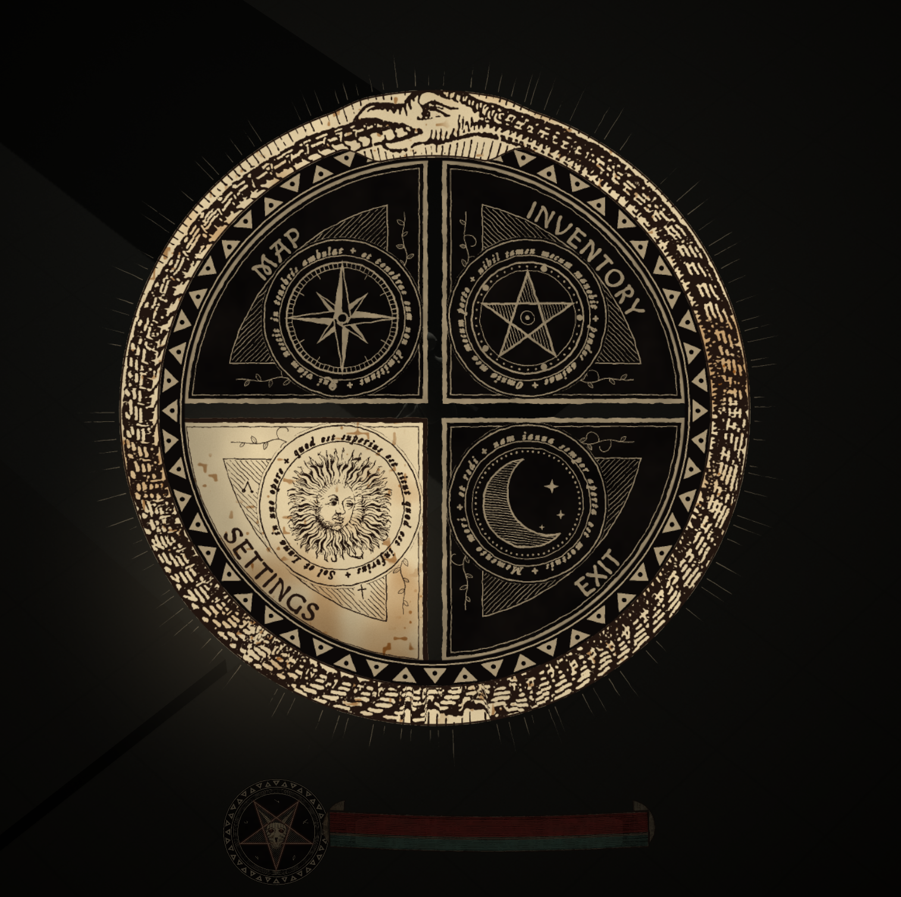
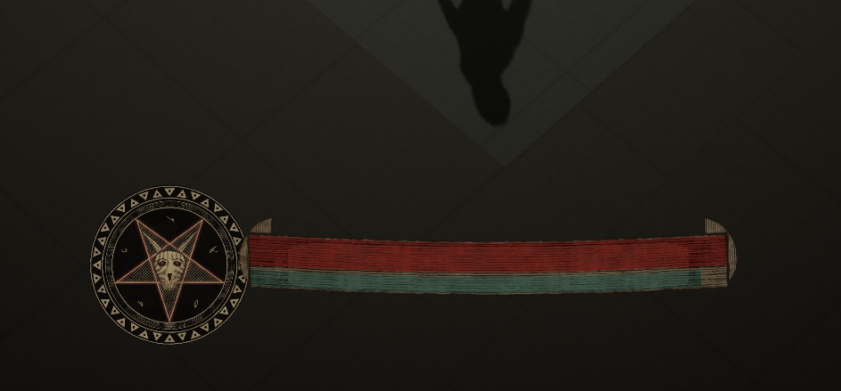
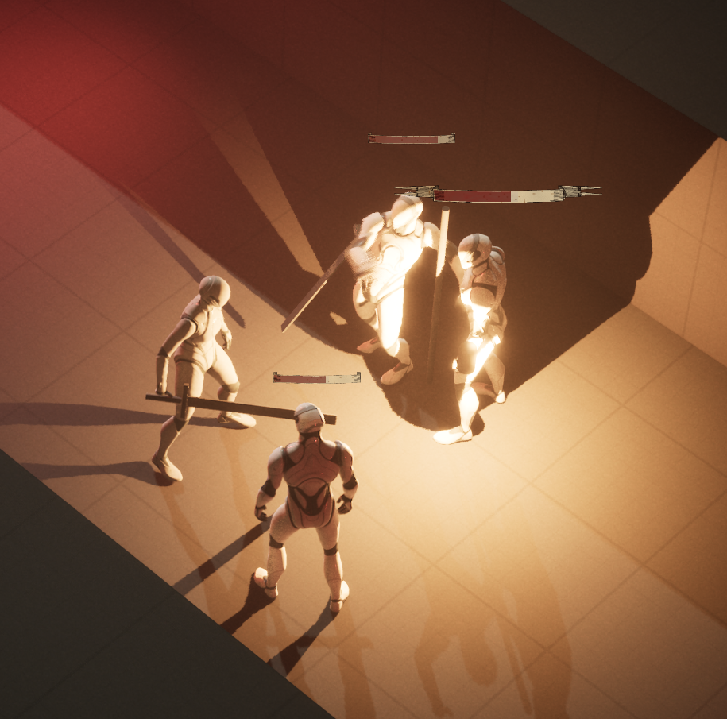
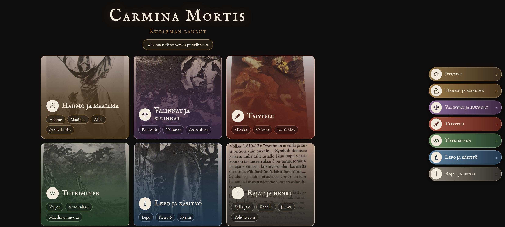
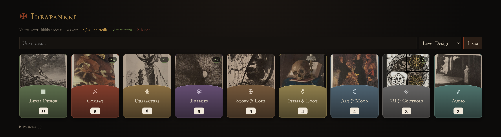
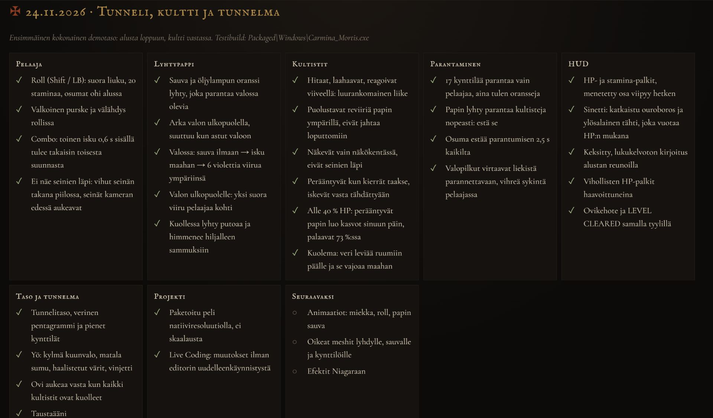
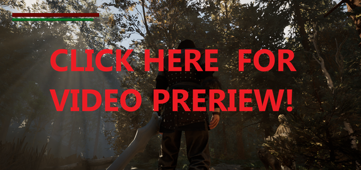
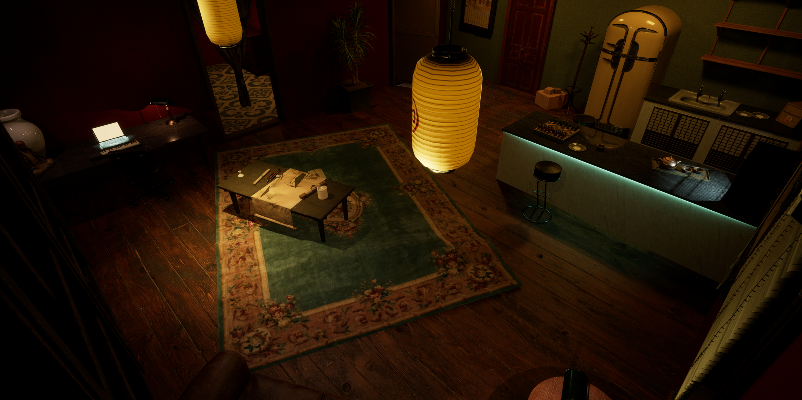

# Korento Interactive 
Welcome! Check out the links below to view my projects.  
*Korento stands for "Dragonfly" in Finnish language*. 📫 [YouTube](https://www.youtube.com/@KorentoInteractive)  
## Projects
<h1>Carmina Mortis (in active development)</h1>
<h3>Slow, isometric ARPG with Dark Souls grim feel and religious fanaticism theme, inspired by games like Diablo & Dark Souls but thriving for exploration and story more than just slaying enemies for loot.</h3>
<h3>EARLY PROTOTYPE VIDEO:</h3> https://www.youtube.com/watch?v=v8YCrRBdSWw

  

  
  

<h1>Dekalogos (on hold)</h1>

A medieval-themed combat & adventure game featuring an environmental line-trace for climbing and much more. Development started August 2026 — Unreal Engine 5.8.
[Gameplay Preview Video Link](https://www.youtube.com/watch?v=NgPDIMCYHeE)  
Separate URL: https://www.youtube.com/watch?v=NgPDIMCYHeE

<h1>Toivo <i>(abandoned)</i></h1>

Souls-like game with Nordic mythology developed in Unreal Engine 5.

<h1>Developer Diary</h1>  
I will upload some diary of my progression in my studies whenever I feel like it, so everything posted here is not everything learned.

[Link to Developer Diary!](https://github.com/donde94/DEV-DIARY)
<h1>Lost Wisdom</h1>

Psychological Horror in first person view. A man progressively loses his sanity only to realize it much too late. 
Developed in Unreal Engine 5.

<h1>Smaller projects and ideas</h1>

>**Teenage Joyride**  
>Blasting subwoofers, egging teachers' houses and cruising around with your reckless teenage friend group.  
  
>Small tests while learning various topics  
>I will be uploading some quirky game demos along the way so feel free to follow me!

<h1>✦ About Me</h1>

**Over 10 years of experience** in various fields of IT, creative work and customer service. I produce electronic music and play multiple instruments. I love arts and all sorts of creative work, and my passion lies in video games!  
I do sports actively, study many subjects like philosophy and psychology and I am planning on going to Thailand for a kickboxing camp. For now I am devoted to game development mainly!

📫 Feel free to contact me: **korentointeractive@gmail.com**
